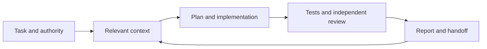

# Agentic Development Kit

Reusable prompts, context templates and review conventions for work with coding agents. Adapt the kit to each repository's stack, contracts and engineering rules.

## Start

1. Read [AGENTS.md](AGENTS.md) and [the master prompt](prompts/master.md).
2. Fill in [current focus](context/current.md), [requirements](context/requirements.md) and [repository ownership](context/repositories.md).
3. Define the intended outcome, permitted repositories, excluded actions and verification commands.
4. Give an agent the master prompt and the task. Use the focused prompts for implementation, review or security assessment.
5. Review the diff, evidence and unresolved work before publication.

Python 3.10+ is sufficient for the included scripts. No third-party Python packages, account credentials or network access are required.

```text
python scripts/validate.py
python scripts/bootstrap.py /path/to/project
```

Bootstrap creates missing instruction/context files and task templates. It never overwrites an existing file, executes a scan, initializes Git or changes application code. Review its proposed changes with `--dry-run` first.

## Contents

| Material | Purpose |
| --- | --- |
| [Prompts](prompts/master.md) | Complete task prompt and focused implementation/review/security prompts |
| [Context](context/README.md) | Small current-state entry point, requirements and decisions |
| [Code quality](standards/code-quality.md) | Engineering and review criteria |
| [Evidence](standards/evidence.md) | Repeatable verification and claim boundaries |
| [Security reporting](standards/security-reporting.md) | Finding taxonomy, spreadsheet fields and report conventions |
| [Templates](templates/task.md) | Task, PR, review, finding, test and ASVS registers |
| [Publication review](docs/publication.md) | Preparing this kit and project outputs for public sharing |



## Operating model

Keep durable engineering rules in the repository. Keep current task facts in context. Keep raw evidence and credentials in restricted storage outside Git. A tool result, source test or generated report establishes only what was actually verified.

The prompts guide an agent; they do not enforce access control or replace human review. Security testing requires authorization for its specific targets and actions. Scope and risk thresholds must be supplied per engagement.

## License

No distribution license is selected in this starter. Choose an appropriate license before publishing. External standards and tools retain their own licenses and terms.
